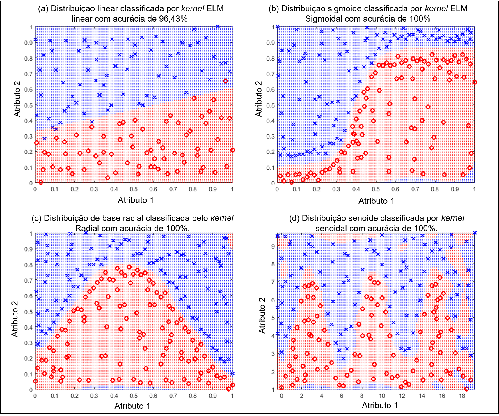
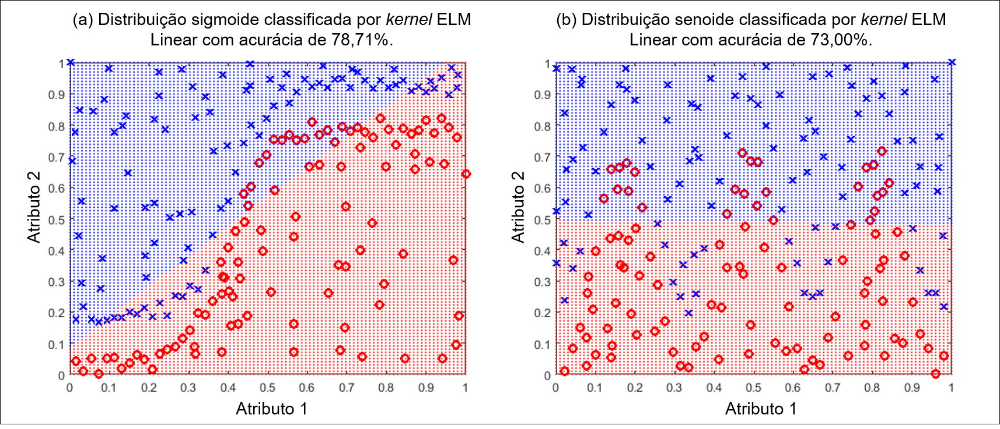

# SVM — Avaliação reprodutível de parâmetros para classificação

Este repositório reúne a versão de pesquisa dos scripts SVM de classificação, baseada em LIBSVM. O foco desta edição é tornar a avaliação mais rastreável e reduzir vazamento de dados durante a validação cruzada. O fluxo principal está em `classification/svmParameters.py` e produz um relatório HTML e arquivos de auditoria.

O projeto parte do repositório [SVM da DejaVuForensics](https://github.com/DejavuForensics/SVM), reorganizado em um único fluxo de classificação com relatórios em português e inglês. Esta cópia contém os arquivos necessários ao fluxo atualizado; versões antigas, ambientes virtuais, relatórios anteriores e bases de malware do repositório original foram deixados de fora.

## Contribuição acadêmica desta versão

A contribuição desta reformulação está na organização e no rigor do processo experimental, não na criação de um novo algoritmo SVM. O fluxo atual inclui:

- validação cruzada estratificada com semente configurável;
- seleção e auditoria de features ajustadas somente com o conjunto de treino de cada fold, evitando que os rótulos dos folds de teste influenciem essa etapa;
- normalização opcional ajustada no treino de cada fold;
- comparação de kernels e valores de C e gamma;
- métricas de classificação, matrizes de confusão e boxplots dos melhores cenários por kernel;
- auditoria CSV completa e outro CSV com somente as features selecionadas;
- relatório HTML com parâmetros experimentais, resultados, diagnósticos e recomendações.

Os diagramas abaixo, mantidos do README anterior, ilustram o comportamento de kernels em distribuições separáveis e não separáveis:





### Estimativa de duração

A estimativa operacional proposta por **WPSS e TMA**, coautoras desta reformulação, aproxima o custo de calcular kernels para pares de amostras e o número de execuções da grade:

\[
T_{SVM} \approx c_k\,N^2\,(F\rho)\,|C|\,|\Gamma_k|\,K,
\]

em que \(N\) é o número de amostras, \(F\) o número de features, \(\rho\) a densidade de valores não nulos, \(|C|\) e \(|\Gamma_k|\) os números de valores de C e gamma usados pelo kernel \(k\), e \(K\) o número de folds. O fator \(F\rho\) aproxima o número médio de features não nulas por amostra. No código, a constante é \(2\times10^{-7}\), com multiplicadores heurísticos por kernel: 5 para polinomial e 1,2 para RBF.

Essa forma é uma **regra de triagem operacional**, não uma lei de tempo de treinamento do SVM. A literatura do LIBSVM descreve o treinamento como uma otimização cujo custo observado também varia com os dados, parâmetros, convergência e cache de kernels; ela não valida os fatores numéricos desta fórmula. O modelo e a biblioteca são descritos por [Chang e Lin (2011)](https://doi.org/10.1145/1961189.1961199). Os fatores e a constante são hipóteses de planejamento computacional das autoras e devem ser calibrados com tempos medidos em cada ambiente. `--force-all-kernels` desativa o descarte por estimativa, mas não garante um prazo máximo.

## Autoria e orientação desta reformulação

**WPSS (mestranda)** e **TMA (mestranda)** são coautoras desta reformulação, com igual responsabilidade pela repaginação e pelas melhorias descritas neste repositório. O trabalho foi realizado sob a orientação de **SMLL (doutor)**.

## Estrutura

```text
SVM-new/
├── .gitignore
├── converter_libsvm.py
├── requirements.txt
├── classification/
│   ├── heart_scale                   # Dataset de demonstração
│   ├── README_CLI.md                  # Guia detalhado de uso
│   ├── svmParameters.py              # Fluxo principal de pesquisa
│   ├── static/
│   │   └── svm_report_styles.css
│   └── templates/
│       ├── svm_report_template_ptbr.html.j2
│       ├── svm_report_template_en.html.j2
│       ├── svm_report_tabs.js
│       ├── 20141104181643!Logo-upe-site.png
│       └── Brasão-Sigla---PNG---RGB.png
└── docs/
    └── images/
        ├── SVM_1.png
        └── SVM_2.png
```

## Idioma do relatório

O relatório é gerado em português por padrão, sem precisar informar uma opção. Use `--language en` para gerar o HTML e os gráficos em inglês; `--language pt-br` seleciona o padrão explicitamente. O idioma não altera o treinamento nem os CSVs de auditoria. Os dois templates ficam juntos em `classification/templates/`; a pasta contém o fluxo de classificação e não representa um idioma. Consulte o [guia detalhado da linha de comando](classification/README_CLI.md).

O HTML em ambos os idiomas organiza o conteúdo em **Visão geral**, **Comparativos** (quando há boxplots), **Resumo por kernel**, **Diagnósticos** e **Auditoria**. Nos resumos e diagnósticos, o seletor mostra um kernel por vez. As abas funcionam com mouse e teclado; ao imprimir ou salvar em PDF, todas as seções e todos os kernels são exibidos. Sem JavaScript, o relatório permanece legível em sequência. Os gráficos comparativos continuam reunindo os melhores cenários de cada kernel; a navegação não altera as métricas.

## Instalação

Use Python 3.13 para as versões fixadas em `requirements.txt`, como no mELM-new. No PowerShell, crie o ambiente virtual na raiz do projeto e confirme a versão antes de instalar:

```powershell
py -3.13 -m venv .venv
.\.venv\Scripts\Activate.ps1
python --version
python -m pip install -r requirements.txt
```

Em sistemas com `python` já apontando para Python 3.13, o equivalente é:

```bash
python -m venv .venv
```

Ative o ambiente virtual e instale as dependências:

```bash
python -m pip install -r requirements.txt
```

## Execução

Entre na pasta do script de classificação:

```bash
cd classification
```

Para verificar o fluxo com o dataset de demonstração e uma grade reduzida:

```bash
python svmParameters.py --demo --quick-test
```

Para gerar o mesmo relatório de demonstração em inglês:

```bash
python svmParameters.py --demo --quick-test --language en
```

Esse modo serve para verificar a execução ponta a ponta. Não deve ser usado como resultado experimental final.

Exemplo de execução experimental com dataset próprio no formato LIBSVM:

```bash
python svmParameters.py -dataset caminho/para/dados.libsvm -kernels all -costs 1,10,100 -gammas 0.01,0.1,1 -kfold 10 -seed 42 -normalization maxabs
```

O script também aceita `-threshold` para definir o limiar mínimo de correlação das features. A remoção de features com correlação próxima de 1 com o rótulo é controlada por `-leakage-threshold`. As opções e seus valores padrão estão disponíveis em:

```bash
python svmParameters.py --help
```

O [guia detalhado da linha de comando](classification/README_CLI.md) explica como limitar a grade e os kernels, como funciona `-max-time` e quando `--force-all-kernels` deve ser usado, além de documentar a auditoria e a interpretação dos resultados.

Para converter um CSV ou XLSX para LIBSVM, use `converter_libsvm.py` a partir da raiz do repositório. Exemplo:

```bash
python converter_libsvm.py dados.csv dados.libsvm --label classe --negative-label benign --positive-label malware
```

Para rótulos textuais, informe explicitamente as classes negativa e positiva; o conversor grava o rótulo negativo como `0` e o positivo como `1`. Para rótulos numéricos, são aceitas as convenções `0/1` e `-1/1`. O conversor salva o arquivo convertido em `Antiviruses/`, criada ao lado do próprio conversor.

## Arquivos gerados

Os resultados são gravados em `svm-results/` dentro do diretório atual de execução. Ao seguir os exemplos e executar a partir de `classification/`, essa pasta ficará dentro desse diretório. Ela contém:

- `svm_report_<data-hora>.html`: relatório da execução;
- `svm_feature_audit_<data-hora>.csv`: auditoria de todas as features por kernel, configuração e fold;
- `svm_feature_audit_<data-hora>_selected.csv`: somente as linhas de features selecionadas;
- `svm_report_images_<data-hora>/` (ou `svm_report_images_en_<data-hora>/`): imagens de cada relatório, mantendo os arquivos de execuções e idiomas distintos separados.

Os resultados gerados são ignorados pelo `.gitignore` e não devem ser enviados junto com o código-fonte.
O HTML referencia o CSS e os logotipos da pasta do projeto; preserve essa estrutura ao abrir ou compartilhar o relatório.

## Interpretação metodológica

A seleção de features é supervisionada, pois usa a correlação com os rótulos. Por isso, cada fold ajusta essa seleção somente com seus dados de treino e aplica o resultado ao fold de teste correspondente. A mesma regra vale para a normalização. Esse procedimento reduz vazamento de informação durante a avaliação por cross-validation.

O script testa diferentes configurações e escolhe os melhores cenários usando os resultados dos folds. Essa seleção pode tornar a métrica escolhida otimista quando ela também é apresentada como estimativa final de generalização. Para uma estimativa final independente, use validação cruzada aninhada ou um conjunto de teste que não participe da escolha de features, kernel ou hiperparâmetros.

## Dados de demonstração

`heart_scale` é incluído para demonstração do formato e do funcionamento do script. Não representa uma base de malware; portanto, resultados de demonstração não devem ser interpretados como desempenho de detecção de malware. Bases de malware e outros datasets do repositório anterior não foram copiados. Para novos datasets, documente a origem e a citação correspondente.

## Referência do projeto de origem

- [DejaVuForensics/SVM](https://github.com/DejavuForensics/SVM)
- Chang, C.-C. e Lin, C.-J. **LIBSVM: A library for support vector machines**. *ACM Transactions on Intelligent Systems and Technology*, 2(3), 27:1–27:27, 2011. [DOI](https://doi.org/10.1145/1961189.1961199).
